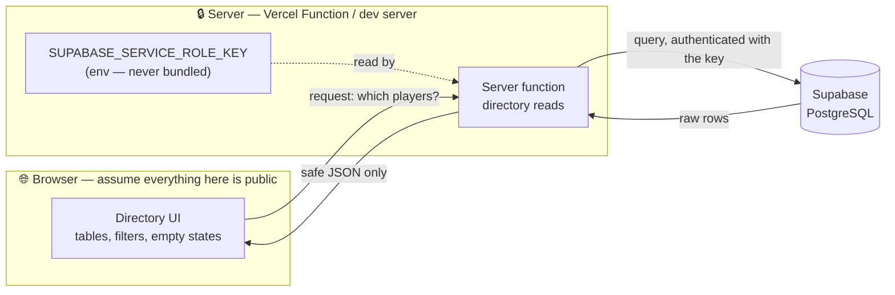

# Client vs server inventory — Hockey Operations Directory (Sprint 2, Topic 2)

**Date:** 2026-09-18
**Status:** Planning — no implementation code in this file
**Related:** `docs/boundary-risk-notes.md` (Sprint 2 Topic 1 — the risks this inventory turns into labels)
**Revises:** `docs/decisions-log.md` D7 — see "A Sprint 1 decision this changes" below

---

## Plain-language model

| Side | Who runs the code? | Who can read it? | Can it hold secrets? |
| --- | --- | --- | --- |
| **Browser client** | The user's own device — Chrome/Safari/Edge on a laptop or phone in the arena | Anyone with the page open: view-source, DevTools → Network, DevTools → Sources | **No.** Treat everything here as published to the world. |
| **Server** | Machines we control — the dev server locally, a Vercel Function in production | Us, and the services we call | **Yes.** Service keys and privileged queries live here. |

The everyday version: the **dining room** is the browser — guests see the plate, and they can inspect it. The **kitchen** is the server — the recipe, the pantry key, and the supplier invoice stay back there. A guest may ask for a dish and receive it; they never get handed the key to the walk-in.

Mapped onto this app: the browser renders the players table. The server is the only thing that ever speaks to Supabase with a privileged key. The browser asks "give me the active forwards" and gets back rows — not the key, not the SQL.

---

## 1. Safe on the browser client

Each item names a real file in this repo where possible.

- **Directory page layout and components** — `src/routes/index.tsx`, `src/routes/players/index.tsx`, `src/routes/players/$playerId.tsx`, `src/routes/games/index.tsx`, `src/components/AppNav.tsx`, `src/components/NotFoundPlayer.tsx`.
  *Why:* UI has to run where the user's eyes are. There is nothing to protect in a table layout.
- **Filter controls and the URL search-param logic** — `src/lib/searchSchemas.ts`, `src/lib/playerParams.ts`.
  *Why:* These validate and normalize text from the address bar. They hold no credentials, and the user already controls the input — they typed the URL.
- **Calling a server function and rendering the JSON it returns.**
  *Why:* The browser sees only the result. This is the whole point of the boundary.
- **Data already on screen** — player name, number, position, team, game opponent/date/venue/result.
  *Why:* Once it is rendered, it is visible by definition. Protecting a field the page displays is not achievable client-side; the decision to show it must be made on the server.
- **Genuinely public config**, clearly named — e.g. the Supabase project URL and anon key *if* we adopt them. These may carry Vite's `VITE_` prefix.
  *Why:* The anon key is designed to be seen and is gated by row-level security in the database. Secret vars never get that prefix.

---

## 2. Must stay on the server

- **The Supabase service role key**, and any credential that is not explicitly public.
  *Why:* It bypasses every row-level security rule. In the browser bundle it is a full database breach, not a partial one.
- **Constructing the privileged Supabase client** — a server-only module, e.g. `src/server/supabase.server.ts`, imported by server functions only.
  *Why:* Whatever a route component imports, Vite bundles and ships. The import graph decides what leaks, not the filename.
- **The database reads that use those credentials** — the real versions of `listPlayers`, `getPlayerById`, `listGames`, `directorySummary`.
  *Why:* The query runs where the key is. Keeping the key server-side means keeping the query server-side too.
- **Deciding which rows and which columns the caller may see.**
  *Why:* A filter applied in the browser is a suggestion — anyone can edit the request. Only a server-side decision is enforceable. This matters more than usual here: there is still no login (Sprint 1 handoff), and the app is on a public URL.
- **Environment loading for secret vars**, including **Vercel dashboard Environment Variables** in production.
  *Why:* `.env` only covers the dev machine. Production secrets live in the Vercel project settings per `docs/vercel-hobby-setup.md` — and must not be `VITE_`-prefixed there either.
- **Raw Supabase error objects.**
  *Why:* They can echo request configuration. The server should catch them and hand the UI a plain sentence like "Directory unavailable — try again."

**Mappers are a special case.** A pure mapper — raw row in, display shape out — is *safe to write as a standalone, testable module* with no secrets in it. But the mapper does not decide the boundary; the **call that fetches the row** does, and that stays server-side. Keeping mappers pure is what makes the first Vitest suite possible.

---

## 3. Boundary questions still open

- **Which columns may cross to the browser at all?** The seed rows carry `status: 'ir'` — injured reserve. On a real roster that is health-adjacent information about a named person, and today it would render on a public page with no login. Does IR status ship to the client, get coarsened to "unavailable", or wait for the auth sprint? *This is a boundary question about data, not about keys, and Topic 1 did not cover it.*
- **Which env var names we standardize on**, public vs secret — and the matching entries in the Vercel dashboard.
- **The server-function request/response contract** for directory lists — does it take the existing `PlayersFilter` shape or something narrower?
- **Where filtering happens:** in the Supabase query, or in pure mappers after the fetch? The Sprint 1 handoff recommends database functions for list/filter logic; that pulls filtering toward the server.
- **Do staff rows live in a separate table from players**, with different visibility rules?

---

## A Sprint 1 decision this changes

`docs/decisions-log.md` **D7** says a later sprint "swaps the helper bodies for Supabase with no route changes." Following that literally would leak.

`src/server/directoryLoader.ts` is imported **directly** by the three route files, and a TanStack Start route `loader` runs on the server for first paint **and in the browser on client-side navigation**. So that module is already in the client bundle graph. Put a service role key in its body and the key ships.

**Amendment:** the route files *do* change. They call a server function; the credential-touching code moves behind that boundary. D7's intent — "route components shouldn't care where data comes from" — survives; its "no route changes" clause does not.

---

## Diagram — secrets only on the right



ASCII fallback:

```
Browser (public)          |  Server (trusted)         |  Data
--------------------------|---------------------------|------------
Directory UI  --request--> |  Server function -------> |  Supabase
              <--safe JSON-|  ^ reads SERVICE_ROLE_KEY |
                           |    (never crosses left)   |
```

**The key never crosses the vertical bar.** Nothing on the left is secret.

**Rule of thumb:** if leaking it would let a stranger read or change hockey ops data — or read something about a person they shouldn't — it belongs on the server side.

---

## Self-check: what could a stranger abuse?

Pressure-testing my own section 1, since that is where mistakes hide:

- **Player names + numbers + team** — low risk. This is public-facing roster information.
- **IR status** — *flagged.* On a public page with no login, this reveals who is injured. It sits in section 1 today only because the seed data is fake. Moved to an open question above; revisit before connecting real rows.
- **Search-param validators** — low risk. They fail safe to documented defaults (verified Sprint 1: `?position=NOPE` → `/players`).
- **The server function's URL and request shape** — visible in the Network tab, and that is fine *provided* the server validates its own inputs. It must never trust a filter value just because our UI sent it.

---

## How I will use this inventory in later steps

- Check every new `import` and every env read an agent proposes against sections 1 and 2.
- Reject any module in the client graph that imports a server-only module or reads a secret env name.
- After `npm run build`, grep `.output/` and `dist/` for `SERVICE_ROLE` — expect zero hits.
- Re-open section 3 when writing the env split and the server-function contract.
